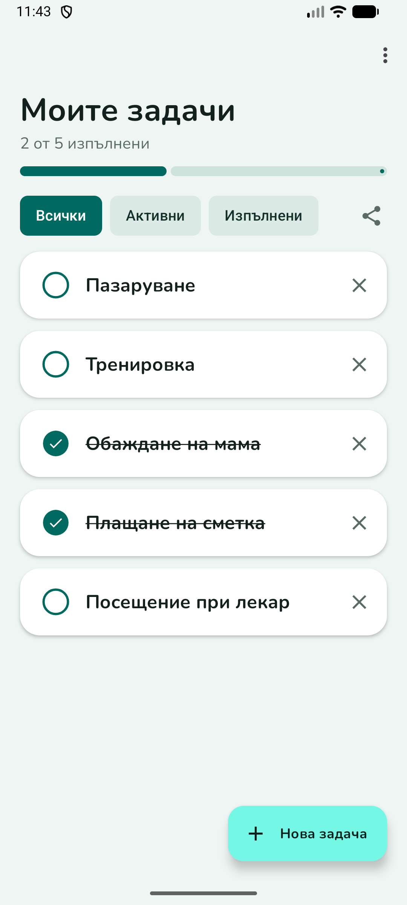
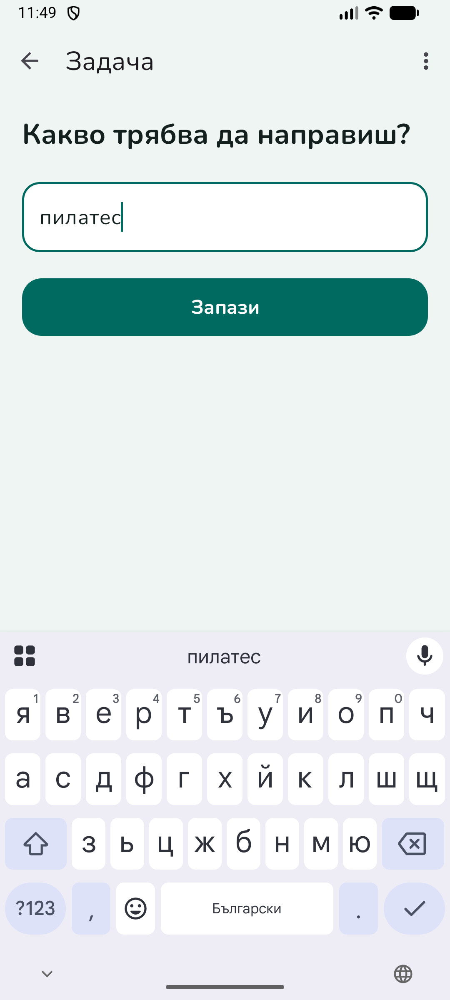
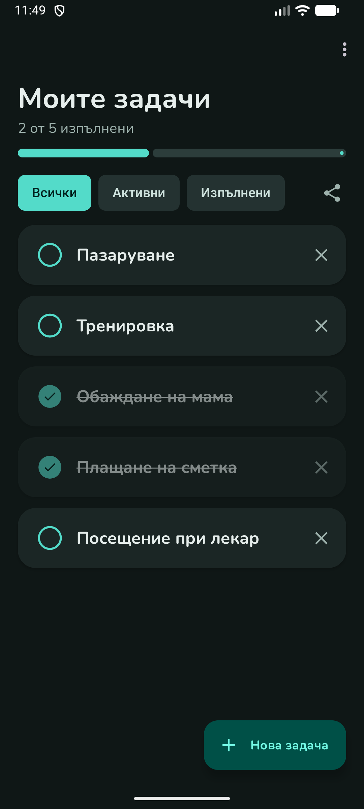
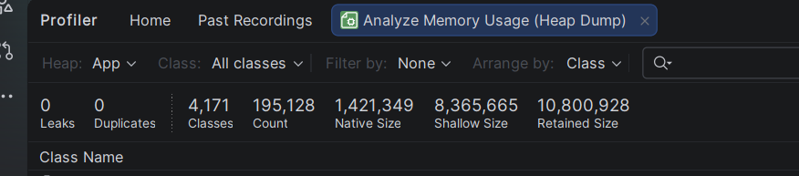

# MyTasks

Android приложение за списък със задачи (To-Do), изработено по курса „Мобилни приложения“.

**Студент:** Ива Славчева, ФН 2401321046, специалност СИ, 3 курс
**Преподавател:** гл. ас. д-р Георги Пашев
**Пакет:** `com.iva.mytasks` · **Min SDK:** 24 · **Език:** Kotlin

## Идея

Просто и бързо приложение за записване на ежедневни задачи. Потребителят добавя задачи, маркира ги като изпълнени, филтрира списъка, може да го изпрати като текст към друго приложение и да изчисти изпълнените задачи с разклащане на телефона.

## Как работи

1. При стартиране `TaskApplication` създава базата данни Room и `TaskRepository`.
2. `TaskListFragment` наблюдава (LiveData) списъка със задачи от `TaskViewModel`. Всяка промяна в базата автоматично обновява екрана.
3. Филтърът (Всички / Активни / Изпълнени) сменя заявката към базата през `switchMap`.
4. „Нова задача“ отваря `AddEditTaskFragment` през Navigation Component. След „Запази“ задачата се записва в Room чрез ViewModel и Repository.
5. Отметката, редакцията и изтриването (✕ или плъзгане, с „Отмяна“) също минават през ViewModel → Repository → Room.
6. „Сподели“ събира списъка като текст (`ShareFormatter`) и го изпраща чрез Share Intent.
7. Докато списъкът е на екрана, `ShakeDetector` слуша акселерометъра. При разклащане `TaskViewModel.clearDone()` изтрива изпълнените задачи (с „Отмяна“). Сензорът се включва в `onResume` и се спира в `onPause`.
8. Данните се пазят в SQLite чрез Room, затова остават след рестарт.

## Функционалности

- Добавяне, редактиране и изтриване на задачи
- Маркиране на задача като изпълнена (зачертава се)
- Филтриране: **Всички / Активни / Изпълнени**
- Лента за прогрес („2 от 5 изпълнени“)
- Изтриване с плъзгане наляво/надясно и възможност за **отмяна** (Snackbar)
- Споделяне на списъка като текст (Share Intent)
- **Разклати за изчистване** (акселерометър): разклащане на телефона изтрива изпълнените задачи, с възможност за „Отмяна“
- Светла и тъмна тема с запомняне на избора
- Данните се пазят локално и остават след затваряне на приложението

## Архитектура

Приложението следва **MVVM** с **Repository** слой:

```
UI (Fragments, RecyclerView)  →  ViewModel  →  Repository  →  Room (SQLite)
```

- **Room** – локална база данни (`Task`, `TaskDao`, `AppDatabase` като Singleton)
- **Repository** – единствен източник на данни за ViewModel
- **ViewModel + LiveData** – състоянието оцелява при завъртане на екрана; `switchMap` за филтрите
- **Dependency Injection** – ръчно, чрез `TaskApplication` (създава базата и Repository) и `ViewModelProvider.Factory`
- **Navigation Component** – два екрана (списък и добавяне/редакция) в една Activity
- **RecyclerView + ListAdapter + DiffUtil** – ефективно обновяване на списъка
- **ViewBinding** – безопасен достъп до изгледите
- **Material 3** – собствена цветова палитра, шрифт Nunito, карти, чипове
- **SensorManager** – акселерометър за функцията „разклати за изчистване“

Приложението не изисква разрешения (permissions) и не ползва мрежа.

## Структура на проекта

```
app/src/main/java/com/iva/mytasks/
├── data/    Task, TaskDao, AppDatabase, TaskRepository
├── ui/      TaskListFragment, AddEditTaskFragment, TaskAdapter,
│            TaskViewModel, ShareFormatter, ShakeDetector
├── MainActivity.kt
└── TaskApplication.kt
```

## Потребителски поток

1. Стартиране → списък със задачите (празно състояние, ако няма такива)
2. „Нова задача“ → въвеждане на текст → „Запази“
3. Докосване на кръгчето → задачата е изпълнена
4. Докосване на текста → редакция
5. Плъзгане или ✕ → изтриване (с „Отмяна“)
6. Чипове за филтър; бутон „Сподели“ за изпращане като текст
7. Разклащане на телефона → изпълнените задачи се изчистват (с „Отмяна“)
8. Меню (⋮) → избор на тема

## Скрийншоти

| Светла тема | Нова задача | Тъмна тема |
|---|---|---|
|  |  |  |

## Стартиране

1. Клонирайте хранилището и го отворете в Android Studio.
2. Изчакайте Gradle Sync.
3. Изберете емулатор или устройство (Android 7.0+) и натиснете **Run ▶** (конфигурация `app`).

## APK

Готов за инсталиране файл: [`apk/app-release.apk`](apk/app-release.apk) (около 6 MB, Min SDK 24).

## Тестове

- **Unit тестове** (JUnit4): `ShareFormatterTest`, `TaskRepositoryTest`, `TaskViewModelTest`, `ClearDoneTest`, `ShakeDetectorTest` – с `FakeTaskDao`
- **UI тестове** (Espresso): `AddTaskFlowTest` – добавяне на задача и валидация на празно заглавие

```
./gradlew testDebugUnitTest
./gradlew connectedDebugAndroidTest
```

## Качество на кода

- Кодът се проверява с **ktlint** (`./gradlew ktlintCheck`) без нарушения.
- **Memory leaks:** проверка с Android Studio Profiler (Heap Dump) след навигация между екраните, редакция и завъртане на екрана. Резултат: **0 leaks**, **0 duplicates**.



## Тестови акаунти

Приложението няма вход и потребителски акаунти – не са необходими.